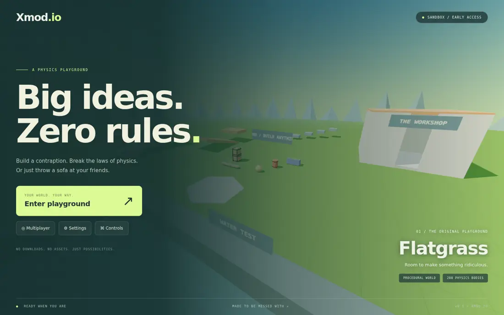

# Xmod.io

An original, browser based physics sandbox. Build and share machines, pose walking dummies, launch sofas, and drive, sail or fly procedural vehicles. All models, sky, textures, UI art, particles, and sounds are generated in code. There are no downloaded art or audio assets.



## Run it

### Play on GitHub Pages

Play at **https://xerox-gh.github.io/Xmod.io/**. Solo play runs entirely in the browser, with no Node server required by players.

1. In this repository's **Settings → Pages**, set **Source** to **GitHub Actions** once.
2. The **Deploy Xmod.io to GitHub Pages** workflow builds and publishes every push to `main`. It can also be run manually from the Actions tab.
3. Once the deploy job succeeds, open the Pages URL above and click **Enter playground**.

`npm run build:pages` produces the uploadable `dist/` directory. Asset paths are relative, so they work at the repository's `/Xmod.io/` subpath. The static build starts in solo mode and does not send requests to a nonexistent multiplayer API. The deploy job also waits for any built-in branch Pages publishing on the same commit, so an old README/Jekyll deployment cannot finish after the game.

GitHub Pages cannot run the Node/WebSocket server. To add multiplayer, host `server/` on a Node host with HTTPS/WebSocket support and enter that origin in the game's **Multiplayer server** field. Set the server's `ALLOWED_ORIGINS` to `https://xerox-gh.github.io`. Optionally set the repository Actions variable `VITE_SERVER_URL` to that HTTPS server origin before rebuilding, to provide it by default. No server is needed for solo tools, physics, ragdolls, weapons or vehicles.

To check the exact static build locally:

```sh
npm run build:pages
npm run test:pages
```

### Run locally

Use **Node.js 22.12+ or 24 LTS** and a desktop browser with WebGL 2 and pointer lock.

```sh
npm install
npm run dev
```

Open the local address Vite prints (normally **http://127.0.0.1:5173**). Solo play works immediately. Click **Enter playground** to capture the mouse; Esc releases it. If the browser refuses pointer lock after a menu closes, click Enter playground again.

For multiplayer, open another terminal in the same project:

```sh
npm run server
```

Choose **Multiplayer**, enter a name and a room ID, and create a room. A second browser can join it from the room list. Vite proxies `/api` and `/ws` to Node on port **3001**. Each browser uses a separate name; no account is required.

### LAN and production

- LAN development: `npm run dev -- --host 0.0.0.0`, then open the Vite address using your computer's LAN IP on the other computers. Run Node on the same machine. Pointer lock requires a browser secure context; use HTTPS when your browser requires it outside localhost.
- Production: `npm run build`, then `npm run server`. Express serves `dist/` and WebSockets from the same origin on port 3001. Put an HTTPS reverse proxy in front and enable WebSocket upgrades for `/ws`.
- `PORT` changes the Node port. If you change it in development, update the proxy target in `vite.config.js` too.
- For a separately hosted client, set `VITE_SERVER_URL` **before building**. Set Node's `ALLOWED_ORIGINS` to a comma separated list of your client origins. See `.env.example`. Node reads environment variables from your shell; it does not automatically load an `.env` file.

## What's new in v0.2

Open **B → Workbench** from the playground, or click **Workbench** on the main menu.

| Area                   | Included                                                                                                                                                                                                     |
| ---------------------- | ------------------------------------------------------------------------------------------------------------------------------------------------------------------------------------------------------------ |
| Builds                 | JSON save/load, XMOD1 copy/paste share codes, one-click connected-contraption duplicator, box selection with group move/delete, undo for deletes and cleanup                                                 |
| Maps                   | Flatgrass, open hills with matching terrain collisions, obstacle course, city block and an empty void with a small starting platform                                                                         |
| Mechanisms             | Adjustable motors with F/J/K/L/U/I/O binds, free hinges, bounded sliders, welds, ropes, wheels, thrusters and balloons                                                                                       |
| Vehicles               | Raycast buggy, tank and motorbike; buoyant boat in Flatgrass's water pit; powered plane with lift and pitch/roll control                                                                                     |
| Things to spawn        | More furniture, solid ramps, hollow pipes, tires, cones, mega basic props, walking jointed NPCs, reactive shooting targets, explosive barrels, trampolines, conveyors, hinged doors, buttons, lamps and neon |
| World controls         | Slow motion, time freeze, Earth/Moon/zero/heavy gravity, four skies, rain/snow, persistent catalog favorites and recents                                                                                     |
| Camera and capture     | First person, third person, vehicle chase and free camera; PNG screenshots, 30-second transform replays with file import/export, WebM canvas video where supported                                           |
| Polish and performance | Joint posing/freezing, spatial WebAudio with replicated impact sounds, auto quality plus overrides, F3 statistics, native physics sleeping and instanced proxies for distant sleeping props                  |

### Save, load and share

**B → Builds** saves selected objects, or the solo world when nothing is selected. In multiplayer it saves your props plus starter world props. Saved builds include sizes, paint, frozen poses, behavioral state, vehicles and constraints. Load a JSON file or generate/copy an **XMOD1** share code and paste it into another browser. Loading **adds** objects to the current map; switch to the saved map first if needed. **Z** undoes an import. Solo builds can contain 200 bodies; online imports use the 60-body per-player allowance. Oldest groups despawn when capacity is needed.

**Q** opens the searchable catalog. The star on each card adds it to **Favorites**; **Recent** remembers up to 30 recently requested props in that browser. **G** releases the mouse for box selection. Drag a rectangle, hold Ctrl to add, then enter an X/Y/Z offset or delete the group. Save selected objects using B. Distant objects still obey edit reach limits.

### Mechanisms and posing

Choose a mode in **B → Tools**, then **Equip tool**, or use slot 2 and press R. Weld, Rope, Motor, Hinge and Slider use two clicks on different props. Motor/Hinge use the first hit as the common pivot; choose X/Y/Z as the rotation or rail axis. Freeze a base with the physics gun to build doors, cranes or pistons. Sliders lock rotation and the other two translation axes, with an adjustable travel limit. Motors and powered wheels use the configured speed and held bind. **Apply speed / bind to aimed motor** edits an existing connection.

Thruster/Wheel/Balloon attach to a surface. Thrusters follow the normal; F powers thrusters and default wheel motors. Balloons lift continuously. Resize grows on LMB and shrinks on RMB, disconnecting old joints to avoid invalid pivots. Paint uses LMB, with RMB cycling colors. Remover deletes an assembly and supports Z. **Duplicator** copies the entire group and constraint-connected graph with one click, offset to the side; Z removes the copy.

Aim at a dummy limb and open **B → Tools**, or select the Pose tool. Enter incremental X/Y/Z joint angles and choose **Rotate joint & freeze**. The chosen limb and its children rotate about the actual joint pivot. **Release dummy** returns the assembly to physics; Z restores the previous pose. Walking NPCs use the same ten-body ragdoll, with simple upright support and gait forces; hits knock them down temporarily.

### Vehicles, behavior props and weapons

**B → Tools** changes the weapon in slot 5 and the vehicle in slot 9. Everything is also available from the prop catalog. E enters/exits a nearby vehicle. The boat floats only inside Flatgrass's water bounds; it is not a general fluid simulation. The plane needs runway space and speed before lift builds. Tank and motorbike use raycast wheels, with differential steering and upright assistance respectively.

Doors toggle with E. Buttons toggle nearby doors owned by the same builder and activate that builder's motors/thrusters while pressed. E also toggles lamps and neon. Trampolines bounce falling bodies and players; conveyors push objects standing on them. Explosive barrels detonate on weapon hits, nearby explosions or hard impacts, with bounded chain reactions. Shooting targets count hits and emit feedback; dummies receive impulses and hit sounds.

Crowbar has a short melee reach, grenades bounce before their fuse expires, the flamethrower repeats while LMB is held and can ignite explosive barrels, and the prop exploder turns a targeted prop into a radial blast. Weapons apply physical effects; there is no player-health/combat progression system.

## Controls

| Input                 | Action                                                                               |
| --------------------- | ------------------------------------------------------------------------------------ |
| WASD / mouse          | Move / look; WASD drives vehicles                                                    |
| Space / Shift / C     | Jump / sprint / crouch-slide; free camera up / faster / down                         |
| V                     | Noclip; Space ascends, C descends                                                    |
| 1–9 / wheel           | Select tool; physics-gun wheel adjusts grab distance                                 |
| Q / B / G             | Prop catalog / Workbench / box selection                                             |
| LMB / RMB             | Primary / secondary tool action                                                      |
| E                     | Enter/exit vehicle, toggle a door/button/light; hold E + mouse to rotate a held prop |
| R / Z                 | Cycle tool mode or reload / undo                                                     |
| F (default)           | Held thruster / wheel / motor activation                                             |
| H / P                 | Toggle slow motion / freeze-resume time (room owner online)                          |
| N                     | Day/night locally                                                                    |
| F5 / F2 / F3          | Cycle camera / save PNG / performance overlay                                        |
| T / Backtick or Enter | Room chat / console                                                                  |
| Esc                   | Release mouse / pause / close catalog or selection                                   |

| Slot | Tool                                                                              |
| ---- | --------------------------------------------------------------------------------- |
| 1    | Physics gun: hold LMB grab, wheel distance, E + mouse rotate, RMB freeze/unfreeze |
| 2    | Tool gun: R cycles all 13 modes                                                   |
| 3    | Prop spawner: LMB selected prop, RMB rotate preview                               |
| 4    | Jointed ragdoll spawner                                                           |
| 5    | Selected weapon (pistol by default)                                               |
| 6    | Scatter blaster                                                                   |
| 7    | Rocket launcher                                                                   |
| 8    | Gravity gun: RMB pickup/drop, LMB launch                                          |
| 9    | Selected vehicle (buggy by default)                                               |

Vehicle controls: buggy/tank/bike use WASD with Space braking. Boat uses W/S thrust and A/D steering. Plane uses W throttle, S drag brake, A/D roll/yaw, Space nose up and C nose down. **B → Capture** selects the camera or records media. Free camera leaves your physical player in place. Chase camera follows an occupied vehicle.

Replays save prop transforms, color/scale changes and camera motion at 10 Hz for up to 30 seconds. Playback interpolates visual copies on the same map; it does not rewind live physics, shared players, sound events or particle history. WebM records the canvas at 30 FPS for up to 30 seconds, without audio; browser codec support is required. PNG capture includes the rendered scene without HTML menus/HUD.

## Console

```text
/help
/spawn barrel
/spawn ragdoll
/spawn car
/gravity 0
/gravity 20
/map hills
/time 0.25
/camera free
/clear
/noclip
/undo
/day
/night
/kick BuilderName
```

`/clear` removes the solo world, or **your** props online. Deletes and `/clear` can be restored with Z or `/undo`. `/gravity`, `/map`, `/time` and `/kick` require room ownership online. The room owner role passes to another player when the owner leaves. Prop editing/removal is limited to the builder, the room owner, or the starter world props. Everyone can grab and push shared props. Undo tracks up to 40 build operations, including destructive cleanup, group moves, pose edits and imports. Changing maps clears history.

## Architecture

```text
client/
  index.html
  src/
    main.js
    core/       renderer, loop, input, settings, effects, weather, quality, recorder
    builds/     build file downloads, import and share codes
    physics/    shared-world entry point and constraint visualization
    player/     predicted controller, camera rig, noclip
    tools/      separate physics gun, gravity gun, tool gun, spawner, view model
    props/      definitions via shared/, geometry cache, mesh registry, ragdoll entry
    weapons/    weapon presentation, ammo, projectile rendering
    vehicles/   buggy/wheel presentation and shared physics entry points
    ui/         menus, hotbar/HUD, catalog, console, multiplayer, chat
    audio/      bounded WebAudio synthesizer
    net/        WebSocket transport, snapshot tracks, avatars/nametags
    maps/       map factory registry and procedural map visuals
server/
  server.js     Express, WebSocket transport and validation/rate limits
  rooms.js      room lifecycle, authority ticks and snapshots
  validation.js input schemas, safe names and token buckets
shared/
  constants.js  protocol and resource limits
  maps.js       collision/visual layout
  props.js      dimensions, categories, materials and masses
  physics.js    cannon-es world setup
  movement.js   shared character controller
  simulation.js entity lifecycle, caps, undo, physics ticks
  actions.js    one validated action dispatcher for solo and online
  builds.js     validated snapshots, share codes, duplication and delete undo
  behaviors.js  NPC gait, door/button interaction, conveyors, trampolines
  slider.js, posing.js, workshop-actions.js
  grabbing.js, constraints.js, ragdoll.js, vehicles.js, combat.js, weapons.js
tests/          physics, movement, tools, assemblies and two-socket integration
scripts/        syntax checks and a real two-browser smoke test
```

### Multiplayer authority

**Physics runs on the Node server**, at a fixed 60 Hz, rather than on a player's browser. Every room owns a separate cannon-es world. The authority validates commands, owns bodies and constraints, drives vehicles, performs weapon raycasts and projectile sweeps, enforces cooldowns/ammo, and simulates player inputs. A host leaving therefore cannot stop the room's physics.

Browsers send movement/look inputs at **20 Hz**. The server broadcasts player and prop transforms at **20 Hz**; spawn, removal, grab, constraint, paint, resize, and weapon events are reliable WebSocket messages. Other players and props interpolate through a **100 ms** snapshot buffer. The local player predicts with the same movement code and reconciles toward server positions. Replica props are kinematic locally, so browsers cannot fight the authoritative simulation.

This is a playable development networking model. It has basic prediction and reconciliation, but not full input replay, lag-compensated combat, or competitive anti-cheat. Rooms are ephemeral: no account system, server-side persistence, permanent bans, or automatic reconnection. Build files and share codes provide manual saves. A room kick disconnects that client; it is not a permanent identity ban. Empty rooms expire after one minute. Props owned by a departing player are cleaned up.

### Limits and performance

- **200 prop bodies per solo world/room**, **60 per player online**, **200 constraints**, **12 players**, **20 rooms**, **32 projectiles**. Oldest groups despawn first; ragdolls count as ten bodies and reserve capacity before spawning.
- Broadphase sorting, sleeping bodies, shared geometries, instanced scenery and 256 pooled particles. Only the first 64 prop objects cast dynamic shadows. Up to eight nearby prop lights are enabled. Sleeping/frozen props beyond 70 units render as simple instanced proxies; Cannon skips sleeping pairs and idle timeouts shorten at distance. NPC support pauses far from players.
- Fixed 60 Hz simulation with a five-step catch-up cap; bounded WebAudio voices, tracers, chat history, and undo stacks. Settings include FOV, sensitivity, volume, shadows, resolution and automatic/low/medium/high quality. F3 shows FPS, body sleep counts, contacts, constraints, physics time and draw calls.
- Server bounds input size, tool/spawn/chat frequency, coordinates, reach, scale, names and message shape. Slow or flooded connections are closed. There are no arbitrary console JavaScript/eval commands.
- The 60 FPS laptop target is a design goal; it has **not been benchmarked on physical mid-range hardware**. Turn off shadows and select Performance resolution on slower integrated GPUs. Large, awake constraint chains are the most expensive case.

## Finished vs planned

**Finished:** the original seven stages plus playable versions of all 22 expansion items listed above. Solo features work on GitHub Pages. Server-authoritative rooms synchronize builds, behavioral props, constraints, map changes and world time; room owners control global physics settings.

**Planned refinements:** richer NPC navigation, terrain-aware walking and animations; detailed vehicle collision hulls and flight tuning; replay player avatars/events/audio; persistent hosted rooms/auth/moderation; full input replay and real-network latency testing; controller/touch support. Furniture and vehicles use conservative collision proxies. Buoyancy is a spring model in the designated water volume, weather is cosmetic, and replay playback is a visual recording rather than a deterministic world rollback.

## Validation

```sh
npm run check
npm test
npm run build
npx playwright install chromium
npm run test:browser
npm run test:expansion
npm run build:pages
npm run test:pages
```

The browser smoke starts its own ephemeral server and Vite instance, uses Chromium, exercises actual menus and pointer lock, spawns/undoes assemblies, fires a weapon, tests noclip, connects two browser clients, checks shared prop counts and safe chat rendering, and writes screenshots to `test-results/`. Tests do not need a hosted service. The expansion browser test covers build downloads/import/share codes, favorites/recents, actual duplication input, selection, five maps, gravity/time, weather/quality, loadouts, free camera, replay save/load/playback and screenshots. Unit/integration tests cover all new rigid-body mechanisms, takeoff/buoyancy, NPC posing, weapons and large multiplayer build imports. CI runs the same checks.

To add a prop, extend `shared/props.js` and `client/src/props/meshes.js`. To add a map, extend `shared/maps.js`, pass its ID to `new Simulation(mapId)`, and register a matching visual factory in `client/src/maps/index.js`; the selector reads the shared map registry automatically. Keep simulation features in `shared/` so offline and online behavior stay consistent. Tool dispatch is wrapped in try/catch so a failing tool can be deactivated without stopping rendering or movement.
